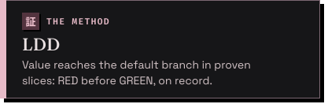
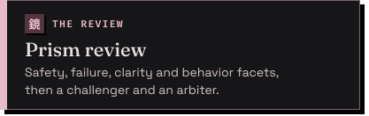

<p align="center">
  
</p>

<p align="center">
  <b>Let the agent run. Deliver only what is proven.</b><br>
  An agent framework for Claude Code and pi.
</p>

<p align="center">
  <a href="https://github.com/jachavarro2004/jhon-agent/blob/main/LICENSE"></a>
  <a href="https://github.com/jachavarro2004/jhon-agent/actions/workflows/validate.yml"></a>
  <a href="https://github.com/sponsors/jachavarro2004"></a>
  <a href="https://github.com/jachavarro2004/jhon-agent/stargazers"></a>
</p>

### Hi, I'm Jhon Chavarro

Backend and distributed-systems engineer. [**Jhon**](https://github.com/jachavarro2004/jhon-agent) is my first open-source project: an agent framework for Claude Code and pi. The agent gets freedom of execution within safety limits, and nothing is delivered without evidence. One orchestrator plans the slices; `jhon-scout` investigates, `jhon-builder` builds a slice, `jhon-checker` checks it from tests that actually ran, and the Prism review reads the frozen diff.

<p>
  <a href="https://github.com/jachavarro2004/jhon-agent#ldd-how-a-change-reaches-the-default-branch"><picture><source media="(prefers-color-scheme: dark)" srcset="assets/ldd-dark.svg"><source media="(prefers-color-scheme: light)" srcset="assets/ldd-light.svg"></picture></a>
  <a href="https://github.com/jachavarro2004/jhon-agent#guards-around-every-tool-call"><picture><source media="(prefers-color-scheme: dark)" srcset="assets/guards-dark.svg"><source media="(prefers-color-scheme: light)" srcset="assets/guards-light.svg"></picture></a>
  <br>
  <a href="https://github.com/jachavarro2004/jhon-agent#agents-one-orchestrator-focused-helpers"><picture><source media="(prefers-color-scheme: dark)" srcset="assets/prism-dark.svg"><source media="(prefers-color-scheme: light)" srcset="assets/prism-light.svg"></picture></a>
  <a href="https://github.com/jachavarro2004/jhon-agent#where-you-work"><picture><source media="(prefers-color-scheme: dark)" srcset="assets/shell-dark.svg"><source media="(prefers-color-scheme: light)" srcset="assets/shell-light.svg"></picture></a>
</p>

### Try it

```sh
curl -fsSL https://raw.githubusercontent.com/jachavarro2004/jhon-agent/main/install.sh | sh
jhon setup
jhon start        # Claude Code, or: jhon start pi
```

Linux (amd64, arm64) or Windows with WSL 2. Every release is signed with cosign. [Read the README](https://github.com/jachavarro2004/jhon-agent#readme) · [Watch the 3:39 presentation](https://github.com/jachavarro2004/jhon-agent#-the-presentation-339)

<details>
<summary>More about me</summary>

Backend and distributed systems, DDD and Clean Architecture, agentic AI. Write to [jhon87195@outlook.com](mailto:jhon87195@outlook.com).

</details>

## The Jhon family

- **[jhon-agent](https://github.com/jachavarro2004/jhon-agent)**: the framework.
- **[jhon-studio](https://github.com/jachavarro2004/jhon-studio)**: presentation videos for any project.
- **[The landing](https://jachavarro2004.github.io/jhon-site/)**: Jhon's site, jachavarro2004.github.io/jhon-site.
- **The profile**: the author's GitHub profile, github.com/jachavarro2004 (you are here).
- **[YouTube](https://www.youtube.com/channel/UCprv0NKifqqMb-zzrBdXb9g)**: Jhon's films, a video for every release.

## Support Jhon

Jhon is free and open source.
If it helps you, donate any amount you choose,
once or monthly, on GitHub Sponsors.
If you can't donate, a ⭐ on the repo helps
keep the project maintained.

[♥ Sponsor on GitHub](https://github.com/sponsors/jachavarro2004)

## License

Apache-2.0: [`LICENSE`](LICENSE). The fonts behind the images in `assets/`: [`LICENSES.md`](LICENSES.md).
