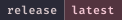
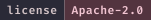
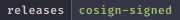
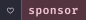
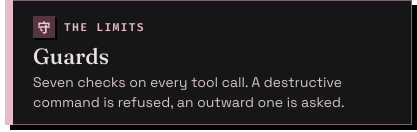
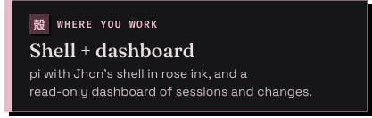

<p>
<picture>
  <source media="(prefers-color-scheme: dark)" srcset="assets/hero-dark.svg">
  <source media="(prefers-color-scheme: light)" srcset="assets/hero-light.svg">
  
</picture>
</p>

<p align="center">
  <a href="https://github.com/jachavarro2004/jhon-agent/releases/latest"><picture><source media="(prefers-color-scheme: dark)" srcset="assets/badge-release-dark.svg"><source media="(prefers-color-scheme: light)" srcset="assets/badge-release-light.svg"></picture></a>
  <a href="https://github.com/jachavarro2004/jhon-agent/blob/main/LICENSE"><picture><source media="(prefers-color-scheme: dark)" srcset="assets/badge-license-dark.svg"><source media="(prefers-color-scheme: light)" srcset="assets/badge-license-light.svg"></picture></a>
  <a href="https://github.com/jachavarro2004/jhon-agent#get-started"><picture><source media="(prefers-color-scheme: dark)" srcset="assets/badge-signed-dark.svg"><source media="(prefers-color-scheme: light)" srcset="assets/badge-signed-light.svg"></picture></a>
  <a href="https://github.com/sponsors/jachavarro2004"><picture><source media="(prefers-color-scheme: dark)" srcset="assets/badge-sponsor-dark.svg"><source media="(prefers-color-scheme: light)" srcset="assets/badge-sponsor-light.svg"></picture></a>
</p>

### Hi, I'm Jhon Chavarro

Backend and distributed-systems engineer. [**Jhon**](https://github.com/jachavarro2004/jhon-agent) is my first open-source project: an agent framework for Claude Code and pi. The agent gets freedom of execution within safety limits, and nothing is delivered without evidence. One orchestrator plans the slices; `jhon-scout` investigates, `jhon-builder` builds a slice, `jhon-checker` checks it from tests that actually ran, and the Prism review reads the frozen diff.

<p>
  <a href="https://github.com/jachavarro2004/jhon-agent#ldd-how-a-change-reaches-the-default-branch"><picture><source media="(prefers-color-scheme: dark)" srcset="assets/ldd-dark.svg"><source media="(prefers-color-scheme: light)" srcset="assets/ldd-light.svg"></picture></a>
  <a href="https://github.com/jachavarro2004/jhon-agent#guards-around-every-tool-call"><picture><source media="(prefers-color-scheme: dark)" srcset="assets/guards-dark.svg"><source media="(prefers-color-scheme: light)" srcset="assets/guards-light.svg"></picture></a>
  <br>
  <a href="https://github.com/jachavarro2004/jhon-agent#agents-one-orchestrator-focused-helpers"><picture><source media="(prefers-color-scheme: dark)" srcset="assets/prism-dark.svg"><source media="(prefers-color-scheme: light)" srcset="assets/prism-light.svg"></picture></a>
  <a href="https://github.com/jachavarro2004/jhon-agent#where-you-work"><picture><source media="(prefers-color-scheme: dark)" srcset="assets/shell-dark.svg"><source media="(prefers-color-scheme: light)" srcset="assets/shell-light.svg"></picture></a>
</p>

### Try it

```sh
curl -fsSL https://raw.githubusercontent.com/jachavarro2004/jhon-agent/main/install.sh | sh
jhon setup
jhon start        # Claude Code, or: jhon start pi
```

Linux (amd64, arm64) or Windows with WSL 2. Every release is signed with cosign. [Read the README](https://github.com/jachavarro2004/jhon-agent#readme) · [Watch the 3:43 presentation](https://github.com/jachavarro2004/jhon-agent#-the-presentation-343)

<a href="https://github.com/sponsors/jachavarro2004"><picture><source media="(prefers-color-scheme: dark)" srcset="assets/sponsor-dark.svg"><source media="(prefers-color-scheme: light)" srcset="assets/sponsor-light.svg"></picture></a>

<details>
<summary>More about me</summary>

Backend and distributed systems, DDD and Clean Architecture, agentic AI. Write to [jhon87195@outlook.com](mailto:jhon87195@outlook.com).

</details>
